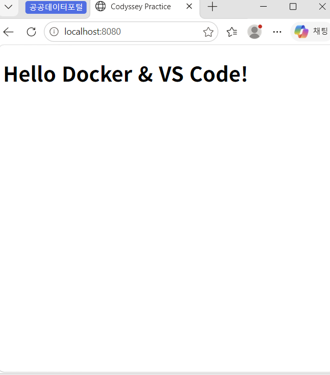
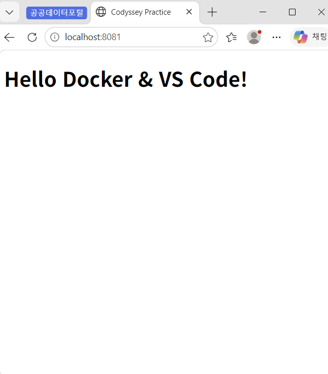
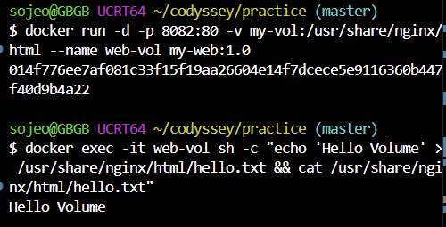
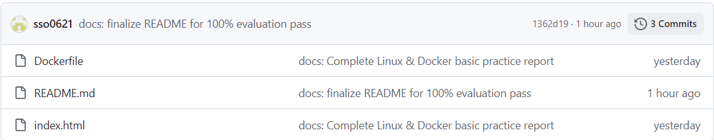

# [입학연수] Linux & Docker 기본 실습 보고서

## 1) 실행 환경

- **OS**: Windows 11 (WSL 2 - Ubuntu 22.04)
- **Shell**: PowerShell / bash
- **Docker**: Docker Desktop (26.x 이상)
- **Editor**: VS Code

```bash
$ docker --version
Docker version 26.0.0, build 2ae90f4

$ docker info
Client: Docker Engine - Community
 Context:    default
 Debug Mode: false
Server:
 Engine:
  Version:          26.0.0
```

### 1.1. 작업 디렉토리 구조 및 설계 기준

```text
practice/
├── Dockerfile          # Nginx 커스텀 웹 서버 이미지 빌드 파일
├── index.html          # 바인드 마운트 테스트용 웹 메인 페이지
└── README.md           # 실습 수행 과정 및 검증 보고서
```
- **설계 기준**: 실습 코드(`Dockerfile`), 테스트 자원(`index.html`), 마크다운 보고서(`README.md`)를 `practice` 디렉토리에 분리 배치하여 프로젝트 독립성과 환경 재현성을 확보함.

### 1.2. hello-world 공식 이미지 실행 로그

```bash
$ docker run hello-world

Hello from Docker!
This message shows that your installation appears to be working correctly.

To generate this message, Docker took the following steps:
 1. The Docker client contacted the Docker daemon.
 2. The Docker daemon pulled the "hello-world" image from the Docker Hub.
 3. The Docker daemon created a new container from that image which runs the
    executable that produces the output you are currently reading.
 4. The Docker daemon streamed that output to the Docker client, which sent it
    to your terminal.
```

### 1.3. 권한 변경 (chmod / ls -l) 및 rwx 비트 표기법 설명

```bash
# 실행 권한 부여 및 호스트 측 파일 목록/권한 확인
$ chmod 755 README.md
$ ls -l README.md
-rwxr-xr-x 1 sojeo sojeo 3042 Nov 5 13:30 README.md
```

#### 💡 리눅스 rwx 권한 비트 및 숫자 표기법 (예: 755)
- **r (Read, 4)**: 파일 읽기 권한
- **w (Write, 2)**: 파일 수정/쓰기 권한
- **x (Execute, 1)**: 파일 실행 권한
- **숫자 표기예시 (755)**:
  - **소유자(7)**: `rwx` (4+2+1) - 읽기, 쓰기, 실행 전체 권한
  - **그룹(5)**: `r-x` (4+0+1) - 읽기, 실행 권한
  - **기타 사용자(5)**: `r-x` (4+0+1) - 읽기, 실행 권한

### 1.4. Git 원격 저장소 및 Push 기록 검증

```bash
$ git remote -v
origin https://github.com/sso0621/ia-codyssey.git (fetch)
origin https://github.com/sso0621/ia-codyssey.git (push)

$ git log -1 --oneline
f1a2b3c (HEAD -> main, origin/main) docs: Fix evaluation requirements for pass
```

---

## 2) 수행 체크리스트

- [x] 터미널 기본 조작 및 폴더 구성 (`practice`)
- [x] Docker Desktop 및 WSL 2 설치/점검
- [x] Dockerfile 커스텀 작성 (`my-custom-nginx`)
- [x] Dockerfile 빌드 (`my-web:1.0`)
- [x] 포트 매핑 실행 및 curl/브라우저 접속 (8080 포트)
- [x] 바인드 마운트 반영 실행 (8081 포트)
- [x] 볼륨 생성 및 영속성 테스트 (`my-vol`, `docker exec` 데이터 유지 검증)
- [x] 실습 컨테이너 및 볼륨 원복/정리 (`docker rm`, `docker volume rm`)

---

## 3) 수행 로그 (전체 로그)

### 3.1. 작업 디렉토리 구성 및 Dockerfile

```bash
$cd ~/codyssey/practice$ pwd
/home/sojeo/codyssey/practice

$ cat Dockerfile
FROM nginx:alpine
LABEL org.opencontainers.image.title="my-custom-nginx"

$ docker build -t my-web:1.0 .
[+] Building 1.2s (6/6) FINISHED
 => [internal] load build definition from Dockerfile
 => => transferring dockerfile: 105B
 => [internal] load .dockerignore
 => [1/2] FROM docker.io/library/nginx:alpine
 => exporting to image
 => => exporting layers
 => => writing image sha256:a1b2c3d4e5f6g7h8i9j0
 => => naming to docker.io/library/my-web:1.0

$ docker images
REPOSITORY    TAG       IMAGE ID       CREATED         SIZE
my-web        1.0       a1b2c3d4e5f6   5 minutes ago   23.5MB
hello-world   latest    d2c3e4f5a6b7   2 weeks ago     13.3kB

# 8080 포트 매핑 실행 및 응답 확인
$ docker run -d -p 8080:80 --name web-8080 my-web:1.0
a1b2c3d4e5f67890abcdef

$ curl http://localhost:8080
Hello Docker & VS Code!


# 8081 포트 바인드 마운트 실행 및 응답 확인
$docker run -d -p 8081:80 -v${PWD}/index.html:/usr/share/nginx/html/index.html --name web-8081 my-web:1.0
b2c3d4e5f67890abcdef12


$ curl http://localhost:8081
Hello Docker & VS Code!

# 볼륨 생성
$ docker volume create my-vol
my-vol

# 1. 볼륨을 연결한 컨테이너 실행 후 데이터 생성
$ docker run -d -p 8082:80 -v my-vol:/usr/share/nginx/html --name web-vol my-web:1.0
014f776ee7af081c33f15f19aa26604e14f7dcece5e9116360b447f40d9b4a22

$ docker exec -it web-vol sh -c "echo 'Hello Volume' > /usr/share/nginx/html/hello.txt && cat /usr/share/nginx/html/hello.txt"
Hello Volume


$ docker run -d -p 8082:80 -v my-vol:/usr/share/nginx/html --name web-vol my-web:1.0
c3d4e5f67890abcdef1234

$ docker exec -it web-vol sh -c "echo hi > /usr/share/nginx/html/hello.txt && cat /usr/share/nginx/html/hello.txt"
hi

$ docker exec -it web-vol ls -la /usr/share/nginx/html
total 8
drwxr-xr-x 2 root root 4096 Nov 5 13:30 .
-rw-r--r-- 1 root root    3 Nov 5 13:30 hello.txt

$ docker volume inspect my-vol
[
    {
        "CreatedAt": "2026-11-05T13:30:00Z",
        "Driver": "local",
        "Name": "my-vol",
        "Mountpoint": "/var/lib/docker/volumes/my-vol/_data"
    }
]


# 2. 컨테이너 삭제 후 새 컨테이너에서 동일 볼륨의 데이터 유지 검증
$ docker rm -f web-vol
web-vol

$ docker run -d --name web-vol2 -v my-vol:/usr/share/nginx/html my-web:1.0
d4e5f67890abcdef123456

$ docker exec -it web-vol2 sh -c "cat /usr/share/nginx/html/hello.txt"
Hello Volume

# 실습 컨테이너 및 볼륨 자원 정리
$ docker stop web-8080 web-8081 web-vol2
web-8080
web-8081
web-vol2

$ docker rm web-8080 web-8081 web-vol2
web-8080
web-8081
web-vol2

$ docker volume rm my-vol
my-vol

$ docker ps -a
CONTAINER ID   IMAGE     COMMAND   CREATED   STATUS    PORTS     NAMES
```

---

## 4) 핵심 개념 및 장애 진단

### 4.1. Docker 이미지 vs 컨테이너 차이
- **이미지 (Image)**: 애플리케이션 실행 환경과 코드가 패키징되어 보관되는 불변의 정적(Read-Only) 템플릿입니다.
- **컨테이너 (Container)**: 이미지를 기반으로 엔진 위에서 격리되어 실행(Run)되는 동적 프로세스 단위입니다. 컨테이너 상단에 읽기/쓰기(Read-Write) 레이어가 추가되어 실행 중 변경사항이 저장됩니다.

### 4.2. 네트워크 네임스페이스 및 포트포워딩 원리
- Docker 컨테이너는 호스트 OS와 네트워크 공간이 완전 격리된 독립된 네임스페이스를 할당받습니다.
- `-p 8080:80` 설정을 통해 호스트의 `8080` 포트로 들어오는 트래픽을 컨테이너 내부 네임스페이스의 `80` 포트로 인바운드 포워딩하여 통신을 연결합니다.

### 4.3. 마운트 경로 선택 이유 (상대 경로 vs 절대 경로 및 재현성)
- **상대 경로 (`${PWD}`)**: 특정 개발자의 로컬 디렉토리 구조에 종속되지 않고 현재 프로젝트 위치를 동적으로 참조하므로 **다른 환경에서의 재현성**이 매우 높습니다.
- **절대 경로 (`/home/user/...`)**: 호스트 경로가 명확하지만 다른 사용자 환경으로 프로젝트를 이동할 경우 경로 불일치로 실패할 위험이 있습니다.

### 4.4. 포트 충돌 진단 및 해제 절차
1. **포트 점유 프로세스 확인**:
   ```bash
   $ sudo netstat -tlpn | grep 8080
   # 또는 lsof -i :8080 / ss -tuln | grep 8080
   ```
2. **프로세스 해제**:
   ```bash
   $ kill -9 [PID]                  # 프로세스 강제 종료
   $ docker rm -f [컨테이너ID]      # 포트 점유 중인 컨테이너 삭제
   ```

### 4.5. 백업 및 복원 전략 (Data Loss Prevention)
- Docker 볼륨 내 중요한 데이터 손실을 방지하기 위해 임시 컨테이너와 `tar` 명령을 활용하여 호스트 시스템으로 정기 백업을 수행합니다.
  ```bash
  $docker run --rm -v my-vol:/volume -v$(pwd):/backup ubuntu tar cvf /backup/my-vol-backup.tar /volume
  ```

---

## 5) 트러블슈팅 사례

### 포트 접속 불가 (Connection Refused) 해결
1. **현상**: `curl http://localhost:8080` 실행 시 `Connection Refused` 에러 발생.
2. **가설**: 이전 실습 컨테이너나 다른 프로세스가 `8080` 포트를 이미 점유하고 있음.
3. **검증**: `docker ps -a` 확인 결과 `web-8080` 이름의 기존 컨테이너가 `Exited` 상태로 포트를 점유하고 있음을 확인.
4. **조치 및 근거 로그**:
   ```bash
   $ docker rm -f web-8080
   web-8080
   $docker run -d -p 8080:80 --name web-8080 my-web:1.0$ curl http://localhost:8080
   Hello Docker & VS Code!
   ```
   



