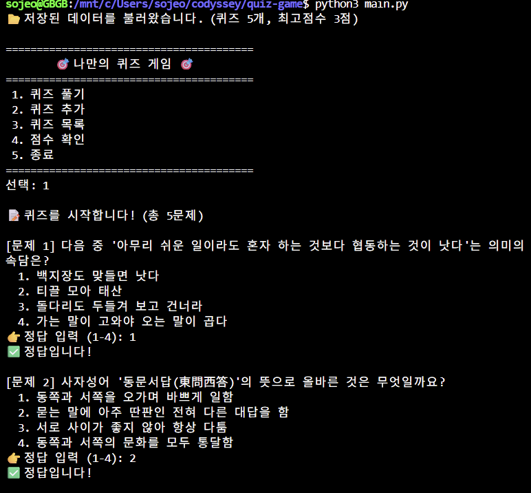
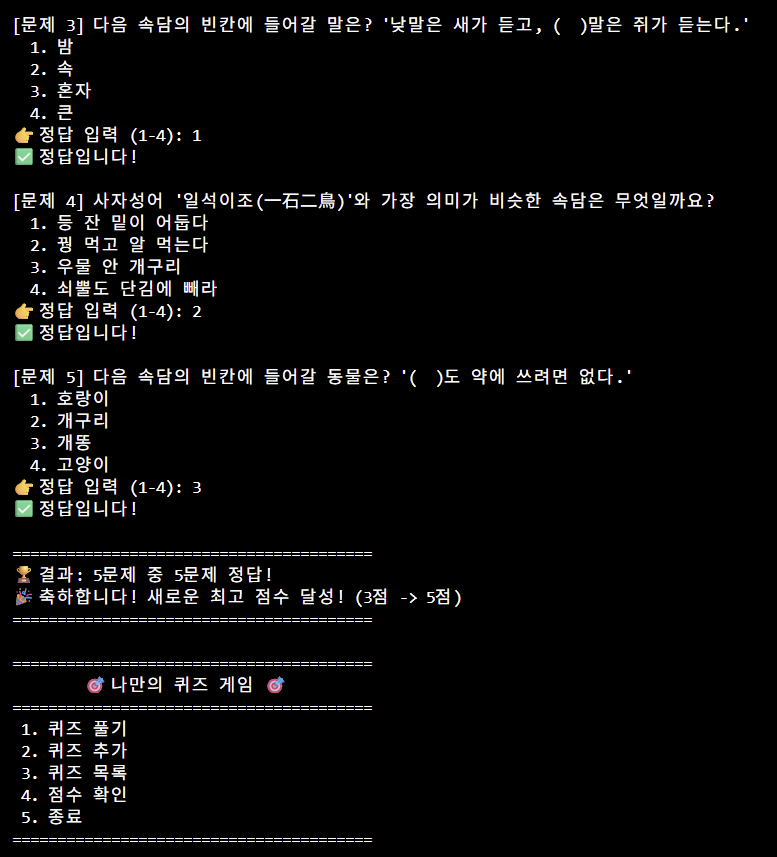
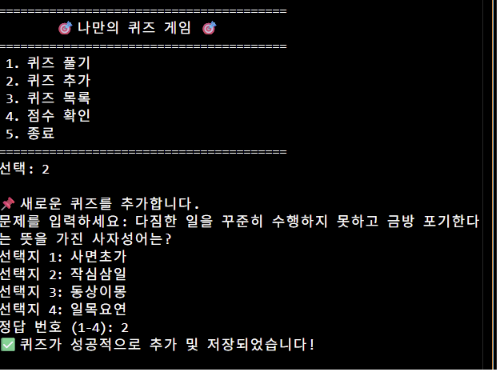
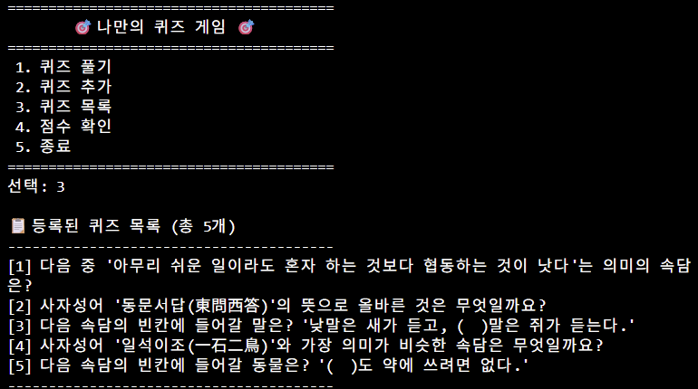

# 🎯 콘솔 기반 나만의 Python 퀴즈 게임

## 1. 프로젝트 개요
Python 3.10 이상 환경에서 외부 라이브러리 없이 표준 라이브러리(`json`, `os`, `sys`)만을 활용하여 구현한 터미널(CLI) 기반 퀴즈 게임입니다.  
객체지향 프로그래밍(OOP) 설계에 따라 개별 퀴즈 데이터를 캡슐화한 `Quiz` 클래스와 게임 진행·파일 입출력·예외 처리를 총괄하는 `QuizGame` 클래스로 구성되어 있습니다. JSON 파일 기반의 데이터 영속성을 적용하여 프로그램 종료 후에도 사용자가 추가한 문제와 최고 점수 기록이 안전하게 유지됩니다.

---

## 2. 퀴즈 주제 선정 이유
- **선정 주제**: 대중적인 한국 속담 및 사자성어
- **선정 이유**: 특정 전공이나 연령대에 치우치지 않고 누구나 친숙하게 즐길 수 있도록 일상에서 자주 쓰이는 속담과 대표적인 사자성어를 주제로 선정했습니다. 간단한 콘솔 퀴즈를 통해 어휘력과 표현력을 자연스럽게 복습할 수 있도록 기획했습니다.

---

## 3. 실행 방법
1. Python 3.10 이상이 설치된 터미널(WSL, Bash, CMD 등)에서 프로젝트 폴더(`week2`)로 이동합니다.
2. 아래 명령어를 입력해 프로그램을 실행합니다.

```
*(운영체제 환경에 따라 `python main.py`로 실행할 수 있습니다.)*

---

## 4. 기능 목록
1. **퀴즈 풀기**
   - 등록된 속담 및 사자성어 퀴즈를 순차적으로 출제하고, 사용자로부터 정답 번호(1~4)를 입력받습니다.
   - 문항마다 즉시 정답 및 오답 여부를 출력하며, 전체 풀이 종료 후 총점을 계산해 최고 기록 경신 시 자동 저장합니다.
   
   
   
2. **퀴즈 추가**
   - 사용자가 직접 새로운 문제, 4개의 선택지, 정답 번호(1~4)를 입력하여 퀴즈를 등록할 수 있습니다.
   - 추가된 퀴즈는 `state.json` 파일에 즉시 기록됩니다.

   
3. **퀴즈 목록**
   - 현재 저장되어 있는 전체 퀴즈의 번호와 문제 내용을 한눈에 조회합니다.
   
   
4. **점수 확인**
   - 현재까지 달성한 최고 점수(`best_score`) 기록을 조회합니다.
5. **종료**
   - 파이썬 실행을 중단함으로써 게임 프로그램을 종료합니다.
   
   

---

## 5. 파일 구조
```text
quiz-game/
├── .gitignore             # Python 캐시(__pycache__) 및 IDE 설정 제외 규칙
└── week2/
    ├── main.py            # Quiz 및 QuizGame 클래스 구현, 메인 게임 루프
    ├── README.md          # 프로젝트 설명 및 데이터 구조 문서
    └── state.json         # 퀴즈 문항 및 최고 점수 영구 저장 파일 (UTF-8)
```

---

## 6. 데이터 파일 설명 (`state.json`)
- **파일 경로**: `week2/state.json` (`week2` 디렉토리 내부 실행 기준 `./state.json`)
- **역할**: 프로그램이 종료되더라도 기존에 등록된 퀴즈 목록, 사용자가 새로 추가한 문제, 최고 점수 기록을 보존하고 재실행 시 불러오는 로컬 데이터 저장소입니다.
- **필드 구조**:
  - `quizzes` (`list[dict]`): 퀴즈 문항 객체들을 담은 배열
    - `question` (`str`): 출제할 문제 내용
    - `choices` (`list[str]`): 4개의 보기 문자열 리스트
    - `answer` (`int`): 정답 번호 (`1` ~ `4` 사이의 정수)
  - `best_score` (`int`): 사용자가 기록한 최고 정답 개수 (초기값 `0`)
