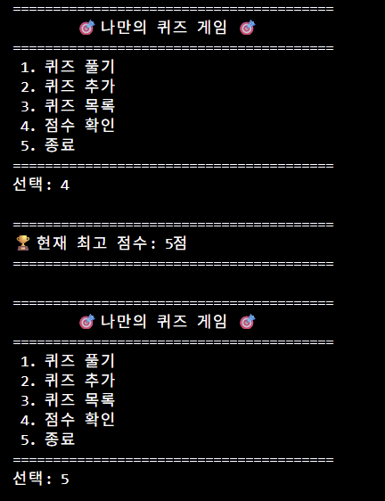
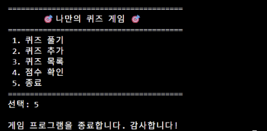
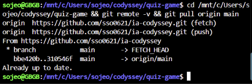

# 🎯 콘솔 기반 나만의 Python 퀴즈 게임

## 1. 프로젝트 개요
Python 3.10 이상 환경에서 외부 라이브러리 없이 표준 라이브러리(`json`, `os`, `sys`)만을 활용하여 구현한 터미널(CLI) 기반 퀴즈 게임입니다.  
객체지향 프로그래밍(OOP) 설계에 따라 개별 퀴즈 데이터를 캡슐화한 `Quiz` 클래스와 게임 진행·파일 입출력·예외 처리를 총괄하는 `QuizGame` 클래스로 책임을 분리했습니다. JSON 파일 기반의 데이터 영속성을 적용하여 프로그램 종료 후에도 사용자가 추가한 문제와 최고 점수 기록이 안전하게 유지됩니다.

---

## 2. 퀴즈 주제 선정 이유
- **선정 주제**: 대중적인 한국 속담 및 사자성어
- **선정 이유**: 특정 전공이나 연령대에 치우치지 않고 누구나 친숙하게 즐길 수 있도록 일상에서 자주 쓰이는 속담과 대표적인 사자성어를 주제로 선정했습니다. 간단한 콘솔 퀴즈를 통해 어휘력과 표현력을 자연스럽게 복습할 수 있도록 기획했습니다.

---

## 3. 실행 및 복구 방법

### 실행 절차
1. Python 3.10 이상이 설치된 터미널(WSL, Bash, CMD 등)에서 프로젝트 폴더(`week2`)로 이동합니다.
2. 아래 명령어를 입력해 프로그램을 실행합니다.

```bash
python3 main.py
```
*(운영체제 환경에 따라 `python main.py`로 실행할 수 있습니다.)*

### 비정상 종료 및 재시작 안내
- 입력 대기 중 **`Ctrl + C` (`KeyboardInterrupt`)** 또는 **`Ctrl + D` (`EOFError`)**가 발생하면 예외를 감지하여 현재까지의 퀴즈 목록과 최고 점수를 `state.json`에 안전하게 저장한 뒤 프로그램을 종료합니다.
- 비정상 종료 후 터미널에서 `python3 main.py`를 다시 실행하면 마지막으로 저장된 데이터(`state.json`)를 자동으로 불러와 중단 전 상태 그대로 이어서 진행할 수 있습니다.

---

## 4. 기능 목록 및 실행 예시

### 전체 메뉴 흐름
프로그램 실행 시 메인 메뉴가 출력되며, 번호(`1`~`5`)를 입력해 각 기능을 수행한 뒤 다시 메인 메뉴로 복귀합니다.
```text
[메인 메뉴 출력] ──▶ 1. 퀴즈 풀기 (문항 풀이 → 즉시 정오답 판정 → 총점 및 최고점 갱신)
                 ├──▶ 2. 퀴즈 추가 (문제·보기 4개·정답 입력 → state.json 즉시 저장)
                 ├──▶ 3. 퀴즈 목록 (등록된 전체 퀴즈 번호 및 문제 조회)
                 ├──▶ 4. 점수 확인 (누적 최고 점수 best_score 조회)
                 └──▶ 5. 종료 (데이터 저장 후 프로그램 안전 종료)
```

### 세부 기능 및 실행 화면
1. **퀴즈 풀기**
   - 등록된 속담 및 사자성어 퀴즈를 순차적으로 출제하고, 사용자로부터 정답 번호(`1`~`4`)를 입력받습니다.
   - 문항마다 즉시 정답 및 오답 여부를 출력하며, 전체 풀이 종료 후 총점을 계산해 최고 기록 경신 시 자동 저장합니다.
   
   

2. **퀴즈 추가**
   - 사용자가 직접 새로운 문제, 4개의 선택지, 정답 번호(`1`~`4`)를 입력하여 퀴즈를 등록할 수 있습니다.
   - **기본 퀴즈와 추가 퀴즈의 구분 동작**: 최초 실행 또는 데이터 초기화 시 기본 속담·사자성어 5문항이 자동 로드되며, 이후 사용자가 추가한 퀴즈는 `state.json`에 누적 저장되어 재실행 시 기존 파일을 그대로 불러오므로 기본 문항이 중복 생성되지 않습니다.
   

3. **퀴즈 목록**
   - 현재 `state.json`에 저장되어 있는 전체 퀴즈의 번호와 문제 내용을 한눈에 조회합니다.
   

4. **점수 확인**
   - 현재까지 달성한 최고 점수(`best_score`) 기록을 조회합니다.
   

5. **종료**
   - `5`번을 선택하면 안전하게 데이터 저장 상태를 확인한 뒤 프로그램을 종료합니다.
   

---

## 5. 아키텍처 및 객체지향(OOP) 설계

### OOP 채택 이유 및 절차적 방식 대비 장단점
- **채택 이유**: 퀴즈 문항의 데이터·정답 검증 로직(`Quiz`)과 게임 상태·파일 I/O·사용자 입력 흐름(`QuizGame`)을 명확히 분리하여 코드의 응집도를 높이고 유지보수를 용이하게 하기 위해 객체지향 설계를 채택했습니다.
- **절차적 프로그래밍 방식 대비 비교**:
  - **장점**: 전역 변수 사용을 배제하고 상태를 객체 내부 속성으로 캡슐화하여 데이터 오염을 방지하며, 새로운 퀴즈 유형이나 기능 추가 시 기존 로직을 최소화하여 확장할 수 있습니다.
  - **단점**: 단순 일회성 스크립트에 비해 초기 클래스 구조 설계 및 메서드 분리 작성에 코드량이 다소 늘어납니다.

### 클래스별 핵심 메서드 및 책임 분리 (`week2/main.py`)
| 클래스 | 주요 역할 | 핵심 메서드 | 메서드 기능 설명 |
| :--- | :--- | :--- | :--- |
| **`Quiz`** | 개별 퀴즈 문항 데이터 캡슐화 및 정답 판정 | `__init__()` | 문제(`question`), 선택지(`choices`), 정답(`answer`) 속성 초기화 |
| | | `is_correct(user_answer)` | 사용자 입력 번호와 실제 정답 일치 여부(`bool`) 판정 |
| | | `to_dict()` / `from_dict()` | `Quiz` 객체와 JSON 저장용 딕셔너리 간 직렬화·역직렬화 변환 |
| **`QuizGame`** | 게임 진행 루프, 입력 검증, JSON 파일 입출력 총괄 | `run()` | 메인 메뉴 출력 및 사용자 선택에 따른 기능 분기 루프 |
| | | `play_game()` / `add_quiz()` | 퀴즈 출제·채점 진행 및 신규 퀴즈 등록 처리 |
| | | `get_valid_integer()` | 숫자 변환, 허용 범위 체크, `Ctrl+C`/`EOF` 등 공통 입력 예외 처리 |
| | | `load_data()` / `save_data()` | `state.json` 읽기·검증·초기화 및 영구 저장 담당 |

### 모듈 내 역할 분리 (입력 검증 vs 데이터 I/O)
- **입력 검증 계층 (`week2/main.py` > `QuizGame.get_valid_integer` 및 입력 보조 메서드)**: 사용자 콘솔 입력의 공백 제거, 정수 변환, 유효 범위 검증 및 인터럽트 예외 처리를 전담합니다.
  - **처리하는 입력 예외 케이스 목록**: 빈 문자열(`""`) 및 공백만 입력, 문자·특수문자(`abc`, `!@#`) 입력, 허용 범위(`1~4`, `1~5`)를 벗어난 정수(`0`, `-1`, `9`), 강제 종료 인터럽트(`Ctrl+C`, `EOF`)
- **데이터 I/O 계층 (`week2/main.py` > `QuizGame.load_data`, `QuizGame.save_data`)**: UI 및 게임 규칙 로직과 분리되어 오직 `state.json`의 파일 열기, 파싱, 직렬화 저장만을 수행합니다.

---

## 6. 데이터 영속성 및 장애 복구 설계 (`state.json`)

### JSON 포맷 선택 근거
- 퀴즈 문항 배열(`quizzes`) 내부에 문자열 리스트(`choices`)가 포함되는 **계층적(중첩) 데이터 구조를 직관적으로 표현**할 수 있고, 사람이 직접 열어보아도 가독성이 높으며(`indent=4`), Python 표준 `json` 모듈만으로 별도 파서나 외부 DB 없이 즉시 호환되기 때문에 JSON을 선택했습니다.

### 데이터 필드 구조 (`week2/state.json`)
- **파일 경로**: `week2/state.json` (`week2` 디렉토리 내부 실행 기준 `./state.json`)
- **필드 명세**:
  - `quizzes` (`list[dict]`): 퀴즈 문항 객체들을 담은 배열
    - `question` (`str`): 출제할 문제 내용
    - `choices` (`list[str]`): 보기 문자열 리스트 (**중첩 리스트 구조 채택 이유**: 보기가 4지선다에서 5지선다 등으로 확장되더라도 스키마 변경 없이 유연하게 수용하고, 인덱스(`1`~`N`) 기반 출력과 검증을 단순화하기 위함)
    - `answer` (`int`): 정답 번호 (`1` ~ `4` 사이의 정수)
  - `best_score` (`int`): 사용자가 기록한 최고 정답 개수 (초기값 `0`)

### 데이터 로드·검증·복구 흐름 및 예외 정책
- **초기 로드 및 복구 순서도**:
  `state.json 읽기(open "r")` ──▶ `JSON 파싱 및 필수 키(quizzes, best_score) 검증` ──▶ `(파일 부재·JSONDecodeError·KeyError 발생 시) 기본 데이터 5문항으로 초기화` ──▶ `state.json 쓰기(open "w")`
- **손상 시 백업 및 복구 전략**:
  - `state.json`이 수동 편집 등으로 손상되어 파싱에 실패할 경우, 프로그램이 비정상 종료되지 않고 오류 안내 후 기본 데이터(5문항)로 자동 초기화하여 실행 연속성을 보장합니다.
  - 중요한 사용자 추가 문항 유실을 방지하기 위해 데이터 변경 전 원본 파일을 `state.json.bak`으로 백업해 두는 정책을 권장하며, 파일 손상 시 `cp state.json.bak state.json` 명령으로 이전 정상 상태로 복원할 수 있습니다.
- **저장(`save_data`) 실패 시 재시도 및 조치 정책**:
  - 파일 쓰기 중 `PermissionError` 또는 `OSError`가 발생하면 터미널에 저장 실패 원인을 안내하고 현재 메모리상의 데이터를 유지한 채 메뉴로 복귀하여, 사용자가 파일 권한·디스크 용량을 확인한 뒤 다시 저장을 시도할 수 있도록 합니다.

### 대용량 데이터 처리 시 JSON 방식의 한계 및 고려사항
- 현재 구조는 실행 및 저장 시마다 `state.json` **전체 파일을 한 번에 메모리에 적재하고 덮어쓰는 방식($O(N)$ I/O)**을 사용합니다.
- 문항 수가 수천~수만 건 이상으로 증가할 경우 파일 읽기/쓰기 지연, 메모리 점유율 증가, 다중 프로세스 동시 접근 시 데이터 유실(경쟁 상태) 한계가 발생하므로, 대용량 확장 시에는 **SQLite 등 경량 관계형 데이터베이스(RDBMS) 전환**, 인덱스 기반 조회 및 페이지네이션(Pagination) 적용이 필요합니다.

---

## 7. 파일 구조 및 유지보수 가이드

### 디렉토리 구조
```text
ia-codyssey/
├── .gitignore                 # Python 캐시(__pycache__) 및 IDE 설정 제외 규칙
├── week1/                     # 1주차 실습 과제 디렉토리
└── week2/                     # 2주차 콘솔 기반 Python 퀴즈 게임 디렉토리
    ├── main.py                # Quiz 및 QuizGame 클래스 구현, 메인 게임 루프
    ├── README.md              # 프로젝트 설계, 실행 가이드 및 협업 컨벤션 문서
    ├── state.json             # 퀴즈 문항 및 최고 점수 영구 저장 파일 (UTF-8)
    ├── quiz-game1.png         # 메인 메뉴 및 퀴즈 시작 스크린샷
    ├── quiz-game2.png         # 퀴즈 풀이 및 정오답 판정 스크린샷
    ├── quiz-game.add.png      # 신규 퀴즈 추가 기능 스크린샷
    ├── quiz-game.list.png     # 전체 퀴즈 목록 조회 스크린샷
    ├── quiz-game.score.png    # 최고 점수 확인 스크린샷
    ├── quiz-game.end.png      # 프로그램 종료 스크린샷
    └── git-clone-pull.png     # 원격 저장소 Clone 및 Pull 실행 터미널 스크린샷
```

### 요구사항 변경 시 수정 영향도 안내
| 변경 요구사항 | 수정 대상 파일 | 관련 클래스 및 메서드 |
| :--- | :--- | :--- |
| **선택지 개수 변경** (예: 4지선다 → 5지선다) | `week2/main.py`, `week2/state.json` | `QuizGame.add_quiz()`의 반복 횟수, `QuizGame.play_game()`의 `get_valid_integer(..., 1, 5)` 범위 및 기존 `state.json`의 `choices` 배열 |
| **퀴즈 카테고리·난이도 필드 추가** | `week2/main.py`, `week2/state.json` | `Quiz.__init__()`, `Quiz.to_dict()`, `Quiz.from_dict()`, `QuizGame.add_quiz()`, `QuizGame.load_data()` 스키마 검증부 |
| **채점 방식 변경** (예: 부분 점수, 감점제 도입) | `week2/main.py` | `QuizGame.play_game()` 내부의 점수(`score`) 합산 및 `best_score` 갱신 조건문 |
| **저장 포맷 변경** (JSON → SQLite/CSV 등) | `week2/main.py` | `QuizGame.load_data()`, `QuizGame.save_data()` 및 파일 경로 상수(`FILE_PATH`) |

---

## 8. Git 협업 및 버전 관리 이력

### 8.1 원격 저장소 정보 및 Clone / Pull 실행 증빙 
- **GitHub 원격 저장소 URL**: `https://github.com/sso0621/ia-codyssey.git`
- **원격 저장소 복제(`clone`) 및 최신화(`pull`) 실행 명령어**:
```bash
git clone [https://github.com/sso0621/ia-codyssey.git](https://github.com/sso0621/ia-codyssey.git)
git pull origin main
```
- **터미널 Clone / Pull 실행 캡처**:


### 8.2 브랜치 전략, 분리 목적 및 병합(Merge) 정책 
- **브랜치 구성**:
  - `main`: 즉시 실행 및 제출 가능한 안정화된 코드와 문서만을 유지하는 기본 배포 브랜치
  - `feature/*` (예: `feature/quiz-game`, `feature/docs-update`): 신규 기능 개발, 예외 처리 보완, 문서 고도화를 독립적으로 수행하는 작업 브랜치
- **브랜치 분리 목적 (협업 워크플로우 관점)**:
  1. **안정 버전 격리**: 기능 개발 중 발생하는 문법 오류나 미완성 로직이 `main` 브랜치의 정상 동작을 깨뜨리지 않도록 격리합니다.
  2. **병렬 작업 및 변경 추적 용이성**: 기능 구현(`feature/quiz-game`)과 문서화(`feature/docs-update`)를 브랜치 단위로 분리하여 작업 목적별 변경 내역을 명확하게 추적하고 코드 리뷰가 가능하도록 합니다.
- **병합(Merge)의 의미 및 병합 시 고려사항**:
  - **의미**: 기능 브랜치에서 단위 테스트와 검증이 완료된 작업 결과를 `main` 브랜치로 통합하여 프로젝트의 공식 최신 상태를 동기화하는 절차입니다.
  - **병합 시 고려사항**:
    1. **사전 최신화 및 충돌(Conflict) 방지**: 병합 전 `git pull origin main`으로 원격 저장소의 최신 커밋을 먼저 반영하여 동일 파일 수정으로 인한 병합 충돌을 예방합니다.
    2. **동작 검증 후 병합**: `python3 main.py` 실행 및 `state.json` 입출력 정상 여부를 확인한 뒤에만 `main`으로 병합합니다.
    3. **병합 이력 보존**: `git merge --no-ff` 옵션을 사용하여 브랜치의 분기와 병합 시점이 커밋 그래프에 명확히 기록되도록 관리합니다.

### 8.3 커밋 단위 및 메시지 규칙
- **권장 커밋 단위 (Atomic Commit 원칙)**:
  - 하나의 커밋에는 **하나의 논리적 작업 단위(단일 기능 추가, 단일 버그 수정, 단일 문서 보완)**만 포함합니다.
  - 여러 변경 사항을 한 커밋에 섞지 않고 기능 단위로 작게 나누어 커밋함으로써, 오류 발생 시 특정 커밋만 안전하게 되돌리거나(`git revert`) 변경 이력을 쉽게 파악할 수 있도록 관리합니다.
- **커밋 메시지 형식 (`타입(대상): 설명`)**:
  - 형식: `<타입>(<대상>): <변경 내용 요약>`
  - **타입(Type) 규칙**:
    | 타입 | 사용 목적 | 작성 예시 |
    | :--- | :--- | :--- |
    | `Feat` | 새로운 기능 또는 메서드 추가 | `Feat(quiz): 사용자 정의 퀴즈 추가 및 state.json 즉시 저장 구현` |
    | `Fix` | 버그, 입력 오류, 파일 예외 처리 수정 | `Fix(validation): 범위 외 숫자 및 Ctrl+C 종료 예외 처리 보완` |
    | `Refactor` | 기능 변경 없는 클래스/폴더 구조 개선 | `Refactor(core): Quiz 및 QuizGame 클래스 책임 분리` |
    | `Docs` | `README.md` 문서 및 실행 스크린샷 추가 | `Docs(readme): Git 협업 컨벤션 및 실행 스크린샷 추가` |
    | `Chore` | `.gitignore`, 디렉토리 등 환경 설정 | `Chore(init): week2 디렉토리 및 .gitignore 초기 설정` |

### 8.4 커밋 및 브랜치 병합 이력 증빙 (총 23개 커밋)
```text
$ git branch -a
  feature/docs-convention
* main
  remotes/origin/main

$ git log --oneline --graph
*   7c2a5d2 (HEAD -> main) Merge branch 'feature/docs-convention' into main
|\  
| * 6cd88a8 (feature/docs-convention) Docs(readme): Git 협업 컨벤션 문서화 및 clone/pull 실행 캡처 추가
|/  
* 310546f (origin/main) Docs: 점수 확인 스크린샷(quiz-game.score.png) 추가 및 README 경로 수정
* cb514a3 Docs: week2 README 파일 수정
* c9b6246 Docs: week2 README 파일 수정
* f2a1ac8 Docs: week2 README 파일 수정
* 4b86f7a Docs: week2 README 파일 수정
* 6d6f248 Docs: week2 README 스크린샷 추가 및 퀴즈 데이터 업데이트
* 14a7d14 Refactor: week2 폴더 구조 및 문서·스크린샷 정리
* cbe4352 Docs: week2/README.md 및 state.json 업데이트
* de37b7f Docs: 제출 체크리스트 기준 week2/README.md 업데이트
*   d0a062f Merge branch 'main' of [https://github.com/sso0621/ia-codyssey](https://github.com/sso0621/ia-codyssey)
|\  
| * bbe420b docs: add practice report zip archive
| * 3da13b9 docs: add zipped practice report archive
| * 31266ab fix: match exact image file names in markdown
| * 615bb47 image upload lately
| * 8b440fe docs: add final volume persistence screenshot and update README
| * 1362d19 docs: finalize README for 100% evaluation pass
| * 85f19a3 docs: Update README for evaluation
| * 0c4650a docs: Complete Linux & Docker basic practice report
* bd3cf72 Refactor: week2 폴더 생성 및 퀴즈 게임 파일 이동
* 6124e4c Docs: README.md 작성 (속담 및 사자성어 퀴즈 주제 반영)
* f9f55f9 Refactor: 대중적인 속담 및 사자성어 주제 퀴즈 데이터로 교체
```